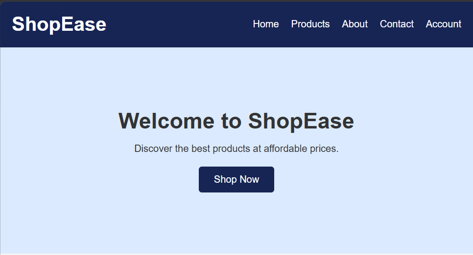
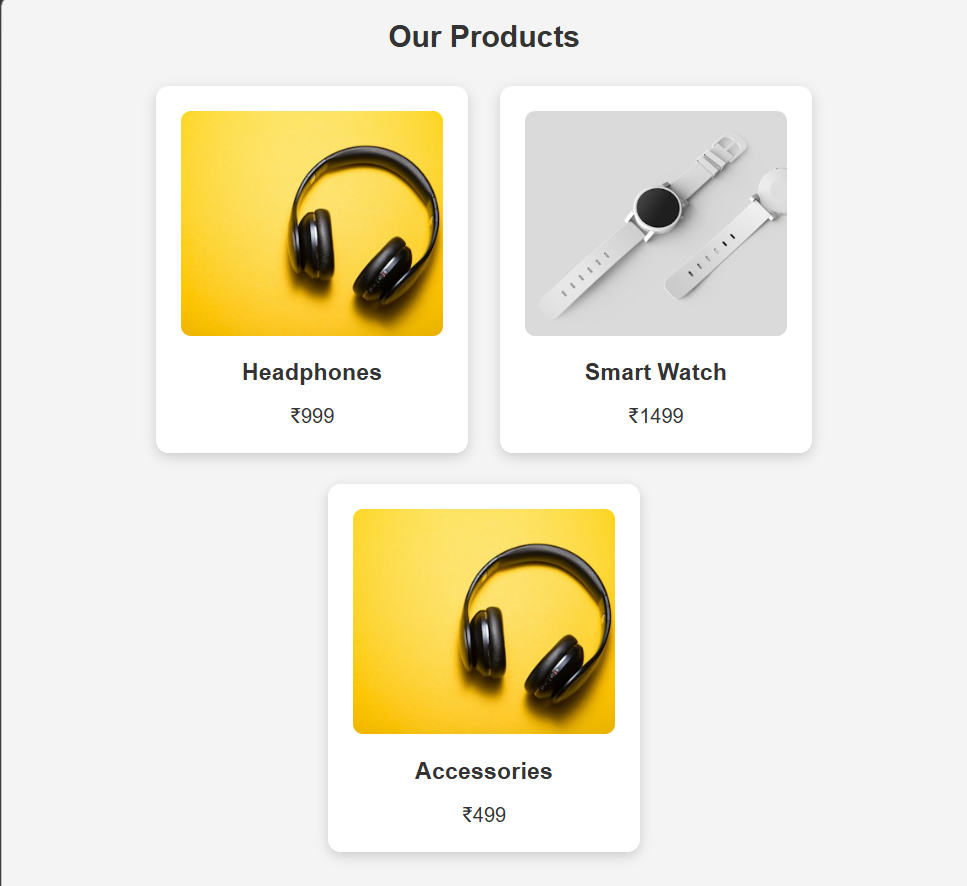
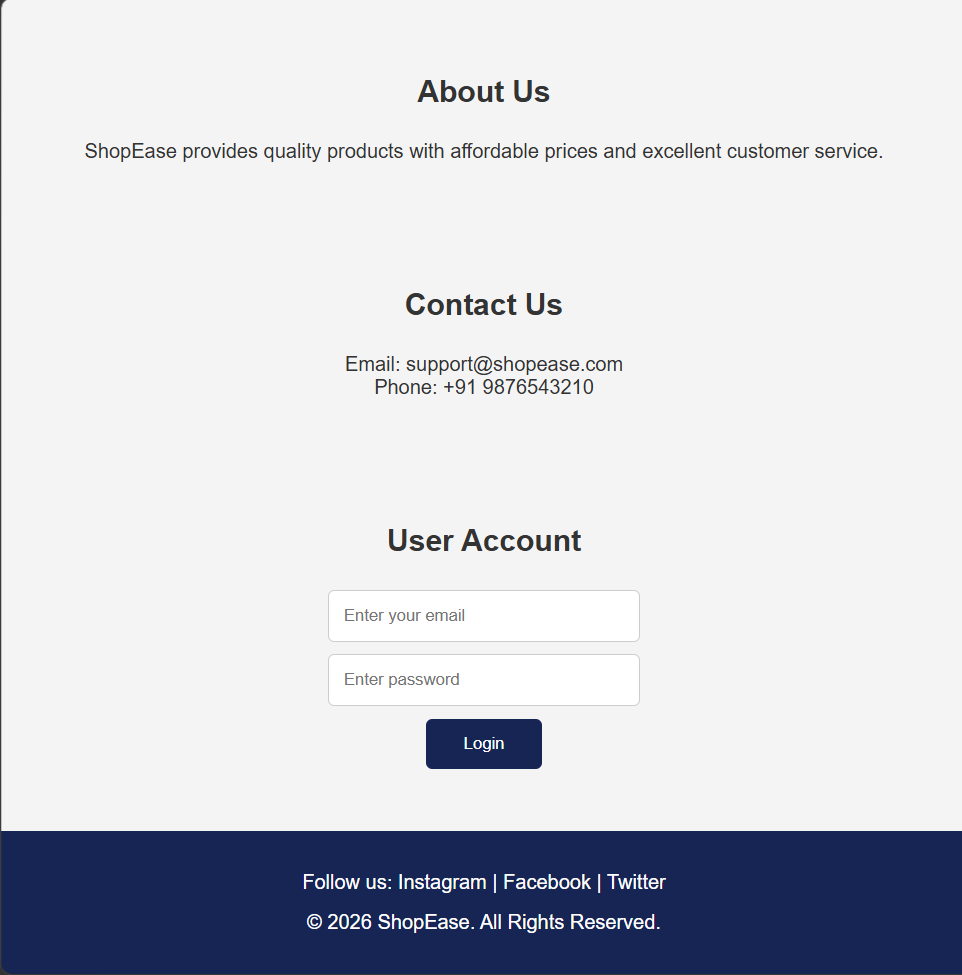

# Ex02 Commercial Website
## Date:30/10/2026
## Name: Mohammed Zubair R
## Reg No: 212225040252

## AIM
To create a commercial website using CSS Flexbox.

## ALGORITHM
### STEP 1
Create an HTML file (index.html)

### STEP 2
Create a CSS file (style.css)

### STEP 3
Include a navigation bar with links to different sections.

### STEP 4
Add structured sections for Homepage, Products / Services, About Us, Contact Details and User Account.

### STEP 5
Include social media links at the footer with copyright information.

### STEP 6
Define global styles for fonts, colors, and layout.

### STEP 7
Style the header, navigation bar, and sections.

### STEP 8
Use Flexbox for layout design.

### STEP 9
Add hover effects and transitions for interactivity.

### STEP 10
Add Images and Media.

### STEP 11
Use optimized images for a professional look.

### STEP 12
Open the HTML file in a browser to check layout and functionality.

### STEP 13
Fix styling issues and refine content placement.

### STEP 14
Deploy the website.

### STEP 15
Upload to GitHub Pages for free hosting.

## PROGRAM

Index.html

```


<!DOCTYPE html>
<html lang="en">
<head>
    <meta charset="UTF-8">
    <meta name="viewport" content="width=device-width, initial-scale=1.0">
    <title>ShopEase - Commercial Website</title>
    <link rel="stylesheet" href="style.css">
</head>
<body>

<header>
    <h1>ShopEase</h1>
    <nav>
        <a href="#home">Home</a>
        <a href="#products">Products</a>
        <a href="#about">About</a>
        <a href="#contact">Contact</a>
        <a href="#account">Account</a>
    </nav>
</header>

<section id="home" class="hero">
    <h2>Welcome to ShopEase</h2>
    <p>Discover the best products at affordable prices.</p>
    <a href="#products" class="btn">Shop Now</a>
</section>

<section id="products">
    <h2>Our Products</h2>
    <div class="product-container">

        <div class="product">
            
            <h3>Headphones</h3>
            <p>₹999</p>
        </div>

        <div class="product">
            
            <h3>Smart Watch</h3>
            <p>₹1499</p>
        </div>

        <div class="product">
            
            <h3>Accessories</h3>
            <p>₹499</p>
        </div>

    </div>
</section>

<section id="about">
    <h2>About Us</h2>
    <p>ShopEase provides quality products with affordable prices and excellent customer service.</p>
</section>

<section id="contact">
    <h2>Contact Us</h2>
    <p>Email: support@shopease.com</p>
    <p>Phone: +91 9876543210</p>
</section>

<section id="account">
    <h2>User Account</h2>
    <input type="email" placeholder="Enter your email">
    <input type="password" placeholder="Enter password">
    <button>Login</button>
</section>

<footer>
    <p>Follow us: Instagram | Facebook | Twitter</p>
    <p>&copy; 2026 ShopEase. All Rights Reserved.</p>
</footer>

</body>
</html>

```


Style.css

```


* {
    margin: 0;
    padding: 0;
    box-sizing: border-box;
}

body {
    font-family: Arial, sans-serif;
    background: #f4f4f4;
    color: #333;
}

header {
    background: #172554;
    color: white;
    padding: 20px;
    display: flex;
    justify-content: space-between;
    align-items: center;
    flex-wrap: wrap;
}

nav {
    display: flex;
    gap: 20px;
}

nav a {
    color: white;
    text-decoration: none;
    transition: 0.3s;
}

nav a:hover {
    color: #38bdf8;
}

.hero {
    text-align: center;
    padding: 100px 20px;
    background: #dbeafe;
}

.hero h2 {
    font-size: 36px;
    margin-bottom: 15px;
}

.btn {
    display: inline-block;
    margin-top: 20px;
    padding: 12px 25px;
    background: #172554;
    color: white;
    text-decoration: none;
    border-radius: 5px;
}

section {
    padding: 50px 20px;
    text-align: center;
}

section h2 {
    margin-bottom: 25px;
}

.product-container {
    display: flex;
    justify-content: center;
    gap: 25px;
    flex-wrap: wrap;
}

.product {
    background: white;
    padding: 20px;
    width: 250px;
    border-radius: 10px;
    box-shadow: 0 3px 10px #ccc;
    transition: 0.3s;
}

.product:hover {
    transform: translateY(-8px);
}

.product img {
    width: 100%;
    height: 180px;
    object-fit: cover;
    border-radius: 8px;
}

.product h3 {
    margin: 15px 0;
}

input {
    display: block;
    margin: 10px auto;
    padding: 12px;
    width: 250px;
    border: 1px solid #ccc;
    border-radius: 5px;
}

button {
    padding: 12px 30px;
    background: #172554;
    color: white;
    border: none;
    border-radius: 5px;
    cursor: pointer;
}

button:hover, .btn:hover {
    background: #2563eb;
}

footer {
    background: #172554;
    color: white;
    text-align: center;
    padding: 25px;
    line-height: 2;
}

```


## OUTPUT





## RESULT
The program for creating commercial website using CSS Flexbox is executed successfully.